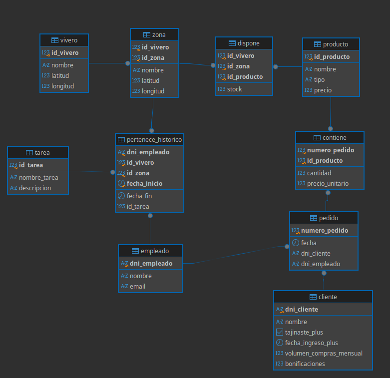

# Modelo-relacional-viveros




## Select de tablas

#### Ventas completas: Pedido + Cliente + Empleado + Contiene + Producto

```
 numero_pedido | fecha_pedido | dni_cliente |   nombre_cliente   | tajinaste_plus | bonificaciones | empleado_responsable |           producto            | categoria_producto | cantidad | precio_unitario | importe_linea 
---------------+--------------+-------------+--------------------+----------------+----------------+----------------------+-------------------------------+--------------------+----------+-----------------+---------------
             1 | 2026-09-10   | 12345678A   | Ana Belén Torres   | t              |          15.00 | Carlos Mendoza       | Tajinaste Rojo                | Plantas            |        2 |           18.50 |         37.00
             1 | 2026-09-10   | 12345678A   | Ana Belén Torres   | t              |          15.00 | Carlos Mendoza       | Sustrato Universal 50L        | Jardinería         |        1 |           12.00 |         12.00
             2 | 2026-09-12   | 23456789B   | Jorge Luis Borges  | t              |           7.50 | Laura Rodríguez      | Monstera Deliciosa            | Plantas            |        3 |           25.00 |         75.00
             3 | 2026-09-15   | 34567890C   | Elena Martín       | f              |           0.00 | Miguel Ángel Pérez   | Tijeras de Poda Profesionales | Jardinería         |        2 |           15.75 |         31.50
             4 | 2026-10-01   | 45678901D   | Roberto Carlos Gil | t              |          26.00 | Carlos Mendoza       | Maceta Cerámica Rústica       | Decoración         |        4 |           22.00 |         88.00
             5 | 2026-10-05   | 12345678A   | Ana Belén Torres   | t              |          15.00 | Sofía Hernández      | Tajinaste Rojo                | Plantas            |        5 |           18.50 |         92.50
(6 rows)
```

#### Histórico de empleados: Pertenece_historico + Empleado + Vivero + Zona + Tarea

```
 dni_empleado |      empleado      |      vivero       |           zona           |     tarea_realizada      | fecha_inicio | fecha_fin  
--------------+--------------------+-------------------+--------------------------+--------------------------+--------------+------------
 11111111A    | Carlos Mendoza     | Vivero La Laguna  | Zona Exterior            | Riego y Mantenimiento    | 2025-01-01   | 2025-06-30
 11111111A    | Carlos Mendoza     | Vivero La Orotava | Invernadero Subtropical  | Aclimatación Invernadero | 2025-07-01   | ACTIVO
 55555555E    | David González     | Vivero Santa Cruz | Almacén Logístico        | Control de Stock         | 2025-08-01   | ACTIVO
 22222222B    | Laura Rodríguez    | Vivero La Laguna  | Almacén Central          | Control de Stock         | 2025-03-01   | ACTIVO
 33333333C    | Miguel Ángel Pérez | Vivero La Orotava | Exposición Decoración    | Atención y Ventas        | 2025-02-15   | ACTIVO
 44444444D    | Sofía Hernández    | Vivero Adeje Sur  | Zona Cactus y Suculentas | Riego y Mantenimiento    | 2025-05-01   | ACTIVO
(6 rows)
```

#### Stock de productos: Dispone + Producto + Vivero + Zona

```
      vivero       |           zona           |  latitud  |  longitud  |           producto            |    tipo    | precio | unidades_disponibles 
-------------------+--------------------------+-----------+------------+-------------------------------+------------+--------+----------------------
 Vivero Adeje Sur  | Zona Cactus y Suculentas | 28.122800 | -16.726100 | Tajinaste Rojo                | Plantas    |  18.50 |                   25
 Vivero La Laguna  | Almacén Central          | 28.487300 | -16.317000 | Sustrato Universal 50L        | Jardinería |  12.00 |                  120
 Vivero La Laguna  | Zona Exterior            | 28.487200 | -16.316900 | Tajinaste Rojo                | Plantas    |  18.50 |                   40
 Vivero La Orotava | Exposición Decoración    | 28.390700 | -16.523200 | Maceta Cerámica Rústica       | Decoración |  22.00 |                   50
 Vivero La Orotava | Invernadero Subtropical  | 28.390600 | -16.523100 | Monstera Deliciosa            | Plantas    |  25.00 |                   35
 Vivero Santa Cruz | Almacén Logístico        | 28.463700 | -16.251900 | Tijeras de Poda Profesionales | Jardinería |  15.75 |                   80
(6 rows)

```


#### Vivero

```
 id_vivero |      nombre       |  latitud  |  longitud  
-----------+-------------------+-----------+------------
         1 | Vivero La Laguna  | 28.487100 | -16.316800
         2 | Vivero La Orotava | 28.390500 | -16.523000
         3 | Vivero Adeje Sur  | 28.122700 | -16.726000
         4 | Vivero Santa Cruz | 28.463600 | -16.251800
         5 | Vivero Tegueste   | 28.516700 | -16.333300
(5 rows)
```
#### Zona

```
 id_vivero | id_zona |          nombre          |  latitud  |  longitud  
-----------+---------+--------------------------+-----------+------------
         1 |       1 | Zona Exterior            | 28.487200 | -16.316900
         1 |       2 | Almacén Central          | 28.487300 | -16.317000
         2 |       1 | Invernadero Subtropical  | 28.390600 | -16.523100
         2 |       2 | Exposición Decoración    | 28.390700 | -16.523200
         3 |       1 | Zona Cactus y Suculentas | 28.122800 | -16.726100
         4 |       1 | Almacén Logístico        | 28.463700 | -16.251900
(6 rows)
```

#### Producto

```

 id_producto |            nombre             |    tipo    | precio 
-------------+-------------------------------+------------+--------
           1 | Tajinaste Rojo                | Plantas    |  18.50
           2 | Monstera Deliciosa            | Plantas    |  25.00
           3 | Sustrato Universal 50L        | Jardinería |  12.00
           4 | Tijeras de Poda Profesionales | Jardinería |  15.75
           5 | Maceta Cerámica Rústica       | Decoración |  22.00
(5 rows)
```

#### Tarea

```

 id_tarea |       nombre_tarea       |                  descripcion                   
----------+--------------------------+------------------------------------------------
        1 | Riego y Mantenimiento    | Cuidado diario, riego y poda de plantas vivas
        2 | Control de Stock         | Recepción de mercancía e inventario en almacén
        3 | Atención y Ventas        | Asesoramiento a clientes y gestión de pedidos
        4 | Aclimatación Invernadero | Control de humedad y temperatura de especies
        5 | Decoración deExpositores | Montaje visual de artículos de decoración
(5 rows)
```

#### Empleado

```

 dni_empleado |       nombre       |        email        
--------------+--------------------+---------------------
 11111111A    | Carlos Mendoza     | carlos@tajinaste.es
 22222222B    | Laura Rodríguez    | laura@tajinaste.es
 33333333C    | Miguel Ángel Pérez | miguel@tajinaste.es
 44444444D    | Sofía Hernández    | sofia@tajinaste.es
 55555555E    | David González     | david@tajinaste.es
(5 rows)
```

#### Cliente

```

 dni_cliente |       nombre       | tajinaste_plus | fecha_ingreso_plus | volumen_compras_mensual | bonificaciones 
-------------+--------------------+----------------+--------------------+-------------------------+----------------
 12345678A   | Ana Belén Torres   | t              | 2025-01-15         |                  300.00 |          15.00
 23456789B   | Jorge Luis Borges  | t              | 2025-06-01         |                  150.00 |           7.50
 34567890C   | Elena Martín       | f              |                    |                   80.00 |           0.00
 45678901D   | Roberto Carlos Gil | t              | 2026-02-10         |                  520.00 |          26.00
 56789012E   | Lucía Méndez       | f              |                    |                   45.00 |           0.00
(5 rows)
```

#### Dispone

```

 id_vivero | id_zona | id_producto | stock 
-----------+---------+-------------+-------
         1 |       1 |           1 |    40
         1 |       2 |           3 |   120
         2 |       1 |           2 |    35
         2 |       2 |           5 |    50
         3 |       1 |           1 |    25
         4 |       1 |           4 |    80
(6 rows)
```

#### Pertenece_historico

```

 dni_empleado | id_vivero | id_zona | fecha_inicio | fecha_fin  | id_tarea 
--------------+-----------+---------+--------------+------------+----------
 11111111A    |         1 |       1 | 2025-01-01   | 2025-06-30 |        1
 11111111A    |         2 |       1 | 2025-07-01   |            |        4
 22222222B    |         1 |       2 | 2025-03-01   |            |        2
 33333333C    |         2 |       2 | 2025-02-15   |            |        3
 44444444D    |         3 |       1 | 2025-05-01   |            |        1
 55555555E    |         4 |       1 | 2025-08-01   |            |        2
(6 rows)
```

#### Pedido

```

 numero_pedido |   fecha    | dni_cliente | dni_empleado 
---------------+------------+-------------+--------------
             1 | 2026-09-10 | 12345678A   | 11111111A
             2 | 2026-09-12 | 23456789B   | 22222222B
             3 | 2026-09-15 | 34567890C   | 33333333C
             4 | 2026-10-01 | 45678901D   | 11111111A
             5 | 2026-10-05 | 12345678A   | 44444444D
(5 rows)
```

#### Contiene

```
 numero_pedido | id_producto | cantidad | precio_unitario 
---------------+-------------+----------+-----------------
             1 |           1 |        2 |           18.50
             1 |           3 |        1 |           12.00
             2 |           2 |        3 |           25.00
             3 |           4 |        2 |           15.75
             4 |           5 |        4 |           22.00
             5 |           1 |        5 |           18.50
(6 rows)
```